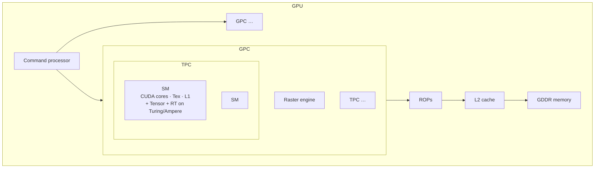

# 01 — How a GPU renders a frame

This is the mental model everything else in Downshift depends on. If you understand *where* the
milliseconds go inside one frame, you understand which milliseconds a layer can take back.

## 1. The journey of one frame

```mermaid
flowchart LR
    A[Game logic<br/>CPU] --> B[Graphics API calls<br/>D3D11 / D3D12 / Vulkan]
    B --> C[Driver / translation layer<br/>NVIDIA driver, or DXVK → Vulkan]
    C --> D[Command buffer<br/>GPU-readable list of work]
    D --> E[GPU front end<br/>command processor]
    E --> F[Geometry: vertex / tessellation / geometry / mesh shaders]
    F --> G[Rasteriser<br/>triangles → fragments]
    G --> H[Pixel / fragment shaders<br/>on SMs]
    H --> I[ROP: depth test, blend,<br/>write to render target]
    I --> J[Post-process passes<br/>AO, SSR, bloom, TAA, upscale, tonemap]
    J --> K[Present / swapchain<br/>→ display]
```

A modern game runs this loop 60–144 times a second. Each stage is a potential bottleneck, but in
2020s games the bottleneck is almost always stages **H** and **J**: the pixel shading and
post-processing work. That is exactly the stage an interposition layer can see and rewrite, because
the game delivers its shaders to the driver as bytecode (DXIL / DXBC / SPIR-V) at runtime.

### 1.1 CPU side

The game decides what to draw and calls the graphics API: "bind this shader, bind these textures,
draw these 40 000 triangles". Thousands of such calls per frame are recorded into **command
buffers**. In D3D12/Vulkan the game records them itself across many threads; in D3D11 the driver does
most of it. On Linux (and increasingly on Windows via projects like DXVK) a *translation layer*
turns D3D calls into Vulkan calls — which is the proof that a program sitting between the game and
the driver can see and alter every call. Downshift sits in the same place.

### 1.2 Inside the GPU — NVIDIA's organisation

An NVIDIA GPU is a hierarchy:

- **GPC** (Graphics Processing Cluster) — contains a raster engine and several TPCs.
- **TPC** — a pair of **SMs** plus a PolyMorph engine (vertex fetch, tessellation, viewport transform).
- **SM** (Streaming Multiprocessor) — the actual compute unit. Holds CUDA cores (FP32/INT32 ALUs),
  load/store units, texture units, register file, shared memory/L1, and — on Turing and later —
  **Tensor cores** and an **RT core**.
- **Warps** — the SM runs threads in groups of 32 called warps. A pixel shader runs the same program
  on a warp of 32 pixels in lockstep. Branch divergence inside a warp wastes lanes.
- **ROPs** (Render Output units) — depth/stencil test, blending, writing final pixels to memory.
- **Memory** — L2 cache, then GDDR5/GDDR6 over a 128–384-bit bus.

**What costs frame time, concretely:**

| Work | Where it runs | What makes it expensive |
|---|---|---|
| Vertex shading | SMs (PolyMorph feeds them) | Triangle count; only a problem with ultra-dense geometry |
| Rasterisation | Raster engine | Tiny triangles (sub-pixel) waste quads — "overdraw" |
| Pixel shading | SMs | Pixel count × shader length × texture fetches × overdraw. **Dominant cost.** |
| Compute passes (AO, SSR, volumetrics, TAA, upscalers) | SMs | Screen resolution and sample count. **Second dominant cost.** |
| Shadow maps | Whole pipeline again, per light | Shadow resolution × number of cascades/lights |
| Ray tracing | RT cores (BVH traversal) + SMs (shading) | Rays per pixel × bounces; without RT cores, traversal falls on the SMs and is ~5–10× slower |
| Memory traffic | GDDR | Texture resolution, render-target count/format, bandwidth |

### 1.3 What the "RTX" units actually do

- **RT core** — a hardware unit that walks a *bounding-volume hierarchy* (BVH) and tests
  ray/triangle intersections. The SMs still run the shader that decides what to do when the ray hits
  something. Pascal (GTX 10 series) has no RT core; NVIDIA's 2019 driver enabled DXR on GTX 1060
  6GB and up by running traversal in software on the SMs, and reviewers concluded it was better
  switched off (Tom's Guide, Laptop Mag — see sources).
- **Tensor core** — a matrix-multiply unit. In games it runs DLSS (AI upscaling/frame generation)
  and some denoisers. Pascal has none, so DLSS is unavailable; **FSR** does the same job with
  ordinary shader math and runs on Pascal.
- **Mesh shaders**, **variable-rate shading (VRS)**, **sampler feedback** — Turing/Ampere features
  bundled with DXR 1.1 into DirectX 12 feature level **12_2** (Microsoft DirectX blog). Pascal is
  feature level 12_1. A game that *requires* 12_2 will refuse to start on a 1060 — see doc 03.

### 1.4 Pascal (GTX 1060) vs Ampere (RTX 3050) in one table

| | GTX 1060 6GB (GP106, Pascal, 2016) | RTX 3050 8GB (GA106, Ampere, 2022) |
|---|---|---|
| Process | 16 nm | 8 nm |
| SMs / CUDA cores | 10 / 1280 | 20 / 2560 |
| RT cores | 0 | 20 |
| Tensor cores | 0 | 80 |
| FP32 throughput | ≈4.4 TFLOPS *(unverified — confirm)* | ≈9.1 TFLOPS *(unverified — confirm)* |
| Memory | 6 GB GDDR5, 192-bit, ≈192 GB/s | 8 GB GDDR6, 128-bit, ≈224 GB/s |
| DX12 feature level | 12_1 | 12_2 |
| DLSS | No | Yes |
| FSR 1/2/3.1 | Yes | Yes |

Note Ampere doubled FP32 units per SM, so "2× CUDA cores" is not 2× real-world speed; composite
benchmarks put the 3050 roughly 40–45 % ahead of the 1060 (videocardbenchmark / hardwaredb — sources).
That is the **raw** gap. The **feature** gap (RT, DLSS, 12_2) is what actually makes games refuse to
run or run badly, and it is the feature gap a layer attacks.

## 2. Where a layer can intervene

Everything the game hands to the API is visible to a layer that sits between them:

| Intercept point | What the layer sees | What Downshift can do |
|---|---|---|
| Shader module creation | Full SPIR-V / DXIL bytecode of every shader | Rewrite: drop RT calls, halve sample loops, reduce texture LOD, replace expensive functions |
| Pipeline / render-pass creation | Render-target formats, sizes, MSAA | Force lower precision formats, smaller shadow/volumetric targets |
| Resource creation | Texture and buffer sizes | Clamp shadow-map / reflection-probe resolution |
| Draw / dispatch calls | Per-pass work | Skip or decimate passes the profile marks "low value" |
| Present | Final image | Inject FSR upscale from a lower internal resolution |

This is the same set of hooks ReShade uses for post-processing and OptiScaler uses to swap
upscalers (doc 04). Downshift generalises it to *every* expensive pass, guided by an agent (doc 06).

## 3. Reference videos and articles (instead of a generated video)

Watch in this order; together they are the "how an NVIDIA card renders great graphics" explainer.

1. **Adrian Courrèges — frame breakdowns** (text, best starting point): "Deus Ex: Human Revolution
   graphics study" and "Supreme Commander" study — walks one real frame through G-buffer, shadow
   map, AO, lighting, bloom, AA, DoF. <https://www.adriancourreges.com/blog/>
2. **NVIDIA — Turing / Ampere architecture whitepapers** (PDF): SM layout, RT cores, Tensor cores.
   <https://www.nvidia.com/en-us/geforce/news/> → search "architecture whitepaper".
3. **Digital Foundry — "How DLSS works" and "Ray tracing explained"** (YouTube): side-by-side
   real game footage with cost explanations. Search the channel for those titles.
4. **Fabian Giesen — "A trip through the Graphics Pipeline 2011"** (text): the definitive
   stage-by-stage explanation of raster, early-Z, warps. <https://fgiesen.wordpress.com/2011/07/09/a-trip-through-the-graphics-pipeline-2011-index/>
5. **GDC Vault — "Advanced Graphics Techniques Tutorial"** series (video): real engine teams
   explaining their frame budgets in milliseconds.

## Sources

- [DirectX blog — New in DirectX: Feature Level 12_2](https://devblogs.microsoft.com/directx/?p=3092)
- [ComputerBase — Feature-Level 12_2 for Turing, Ampere, RDNA 2](https://www.computerbase.de/2020-08/directx-12-feature-level-12-2/)
- [Tom's Guide — Ray tracing comes to GTX GPUs](https://www.tomsguide.com/us/ray-tracing-gtx-gpu-driver,news-29847.html)
- [Laptop Mag — Nvidia brings ray tracing to GTX cards](https://www.laptopmag.com/articles/nvidia-brings-ray-tracing-gtx-cards-heres-enable)
- [hardwaredb — GTX 1060 6GB vs RTX 3050](https://www.hardwaredb.net/geforce-gtx-1060-6gb-vs-geforce-rtx-3050)
- [videocardbenchmark — GTX 1060 vs RTX 3050](https://videocardbenchmark.net/compare/3548vs4495vs4541/GeForce-GTX-1060-vs-GeForce-RTX-3050-vs-Radeon-RX-6650-XT)
- [sysrqmts — GTX 1060 spec sheet (feature level 12_1)](https://sysrqmts.com/fr/gpus/compare/nvidia-geforce-gtx-1060-3-gb-gp104-vs-nvidia-geforce-rtx-3050-mobile)
- [lousodrome — summary of Courrèges' Deus Ex frame study](https://lousodrome.net/blog/light/?p=995)
- [Vulkan Guide — Ways to provide SPIR-V](https://docs.vulkan.org/guide/latest/ways_to_provide_spirv.html)
