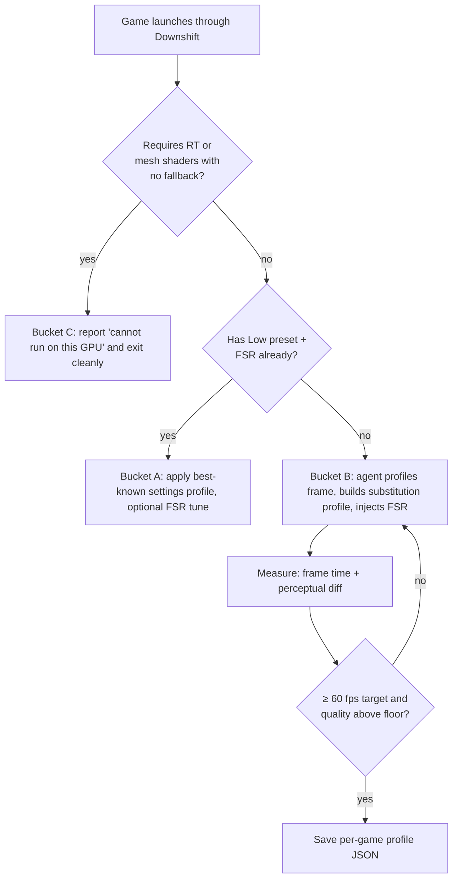

# 03 — The GTX 1060 → RTX 3050 gap, and which games can cross it

## 1. Two different gaps

There are two gaps between the cards and they need different treatment.

### 1.1 The raw-performance gap (bridgeable)

| | GTX 1060 6GB | RTX 3050 8GB | Ratio |
|---|---|---|---|
| CUDA cores | 1280 | 2560 | 2× nominal (Ampere dual-FP32 means ≈1.4–1.5× real) |
| FP32 TFLOPS | ≈4.4 *(unverified)* | ≈9.1 *(unverified)* | ≈2× |
| Memory bandwidth | ≈192 GB/s | ≈224 GB/s | 1.17× |
| VRAM | 6 GB | 8 GB | — |
| Composite benchmark score | 2457 | 3468 | 1.41× (videocardbenchmark) |

Closing a 1.4–1.5× gap by rendering cheaper is routine: FSR 2 "Balanced" alone (59 % internal
resolution) recovers roughly that much, and shadow/volumetric downgrades recover more.

### 1.2 The feature gap (partly unbridgeable)

| Feature | 1060 (FL 12_1) | 3050 (FL 12_2) | Can a layer fake it? |
|---|---|---|---|
| DXR 1.0 ray tracing | Software fallback via driver (very slow) | RT cores | **Replace**, don't fake: redirect RT passes to screen-space fallbacks |
| DXR 1.1 inline RT (`RayQuery`) | No | Yes | Same as above; or vkd3d-proton can expose software RT if the Vulkan driver does *(unverified)* |
| Mesh shaders | No | Tier 1 | **No.** Emulation via compute is possible in theory but not faster than the engine's own vertex path. Needs the engine to have a fallback. |
| Variable-rate shading | No | Tier 2 | Not needed — VRS *saves* work; its absence just means the layer can't use it as a tool |
| Sampler feedback | No | Tier 0.9 | Rarely a hard requirement; engines fall back |
| Shader Model 6.5 / 6.6 / 6.7 | Driver-dependent; vkd3d-proton exposes SM 6.7 on Pascal with workarounds | Yes | Mostly yes |
| DLSS | No tensor cores | Yes | **Replace** with FSR 2/3.1 (shader-based, MIT) |
| DP4a (for XeSS fallback) | No | Yes | Avoid XeSS; use FSR |

## 2. The three buckets

Every game lands in one of three buckets. The agent's first job (doc 06) is to classify.

### Bucket A — already runs on a 1060; the user just needs the right settings

The game ships Low/Medium presets that already use the 2017-era fallbacks. Downshift adds value only
by automating the settings and injecting FSR where the game lacks it.

- Examples: *Cyberpunk 2077* (GTX 1060 is in the official 1080p spec, RT off), most UE4 titles,
  *Elden Ring*, *Resident Evil 4 (2023)* with RT off, *Forza Horizon 5*.

### Bucket B — the target: runs on a 1060 only if the layer substitutes techniques

The game's minimum spec says RTX 2060 / 3050 because its *default* path uses RT or DLSS, or because
it hides the fallback behind a flag, or because it has no upscaler for Pascal. The engine *has*
a non-RT path (console or "low" path) but doesn't expose it cleanly.

- Candidates *(unverified — each needs a profiler capture to confirm its fallback exists)*:
  UE5 Lumen titles with Software Lumen (e.g. many 2023–2025 UE5 releases) — force SW Lumen +
  FSR; titles that bundle DLSS only — inject FSR via the same hooks OptiScaler uses; titles with
  "always-on" RT reflections that still ship SSR code for consoles.

This is where 100 % of Downshift's engineering goes.

### Bucket C — impossible by software; be honest with the user

The engine has **no non-RT path** or requires mesh shaders with **no fallback**. No layer can
make the GPU grow RT cores; software BVH traversal on a 1060 is 5–10× too slow to be playable.

- Examples: *Indiana Jones and the Great Circle* (RT required; GTX 1060 users on Steam forums
  confirm it won't run), *Alan Wake 2* (mesh shaders required at launch; a later patch added a
  slower fallback path — *unverified which GPUs that covers*), *Star Wars Outlaws*, *Doom: The Dark
  Ages* (RT required), *Avatar: Frontiers of Pandora* (RT required).

Downshift must **detect** Bucket C at startup (check for `VK_KHR_ray_tracing_pipeline` /
`VK_EXT_mesh_shader` being *required* rather than optional) and tell the user plainly rather than
crash or render garbage.

## 3. Decision flow

## 4. Target definition for "runs"

"Runs on a 1060" means, for this project: **1080p, ≥ 60 fps average, ≥ 45 fps 1 % low, FLIP /
SSIM perceptual score within an agreed floor of the RTX 3050 Medium preset.** Anything less is
"launches", not "runs". Numbers are revisable in doc 07.

## Sources

- [DirectX blog — Feature Level 12_2 requirements (DXR 1.1, VRS Tier 2, mesh shaders Tier 1, sampler feedback 0.9, SM 6.5)](https://devblogs.microsoft.com/directx/?p=3092)
- [3DCenter — FL 12_2 supported by Turing, Ampere, RDNA 2](https://www.3dcenter.org/print/news/microsoft-bringt-das-directx-feature-level-122-mit-verpflichtendem-support-von-raytracing-und-s)
- [hardwaredb — GTX 1060 6GB vs RTX 3050 (cores, SMs, bandwidth)](https://www.hardwaredb.net/geforce-gtx-1060-6gb-vs-geforce-rtx-3050)
- [videocardbenchmark — composite scores](https://videocardbenchmark.net/compare/3548vs4495vs4541/GeForce-GTX-1060-vs-GeForce-RTX-3050-vs-Radeon-RX-6650-XT)
- [gazlog — RTX 3050 6GB vs 8GB 1080p delta (TechPowerUp data)](https://gazlog.jp/entry/rtx3050-6gb-nerfed-benchmark)
- [Steam forum — Indiana Jones and the Great Circle: RT required, GTX 1060 users](https://steamcommunity.com/app/2677660/discussions/0/604141771964853536)
- [Steam forum — Cyberpunk 2077 GTX 1060 in 1080p High spec](https://steamcommunity.com/app/1091500/discussions/0/3106893419992103814)
- [GamingOnLinux — vkd3d-proton 2.12: Pascal compute-derivative fallback, SM 6.7 on Pascal](https://gamingonlinux.com/2024/03/vkd3d-proton-version-212-adds-nvidia-reflex-support)
- [Phoronix — vkd3d-proton 2.12](https://Phoronix.com/news/VKD3D-Proton-2.12)
- [Tom's Guide — DXR on GTX via software fallback](https://www.tomsguide.com/us/ray-tracing-gtx-gpu-driver,news-29847.html)
