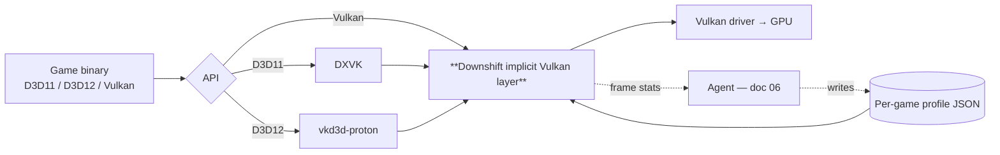

# 05 — Architecture: the Downshift layer

## 1. Where it sits



On Linux / Steam Deck / Proton this covers D3D9–12 and Vulkan games today, because DXVK and
vkd3d-proton already turn them into Vulkan apps. On Windows, Vulkan-native games are covered
immediately; D3D games need the **M4 proxy path** (section 7).

## 2. Loading: Vulkan implicit layer

- Ship `VkLayer_downshift.json` into the loader's `implicit_layer.d` (Linux) or register it in
  `HKLM\SOFTWARE\Khronos\Vulkan\ImplicitLayers` (Windows) — the same mechanism ReShade uses.
- Manifest declares `disable_environment: { "DOWNSHIFT_DISABLE": "1" }` (required for implicit
  layers) and `enable_environment: { "DOWNSHIFT_ENABLE": "1" }` so it is **opt-in per process**
  by default. The launcher sets the env var; nothing else on the system is affected.
- Layer intercepts `vkGetInstanceProcAddr` / `vkGetDeviceProcAddr` and chains to the next layer.
  Standard loader-layer interface; see LunarG docs in sources.

## 3. Intercept points and what each one enables

| Vulkan call | Downshift action | Substitution enabled |
|---|---|---|
| `vkCreateInstance` / `vkCreateDevice` | Read device caps; detect **Bucket C** (game requests `VK_KHR_ray_tracing_pipeline`, `VK_KHR_ray_query`, `VK_EXT_mesh_shader` as *required*); load profile JSON for this executable hash | Capability oracle; refuse cleanly |
| `vkEnumerateDeviceExtensionProperties` | Optionally **hide** RT / mesh-shader extensions so an engine with a fallback path takes it (the same trick Proton uses to steer engines) | Force engine's own non-RT path — cheapest possible substitution |
| `vkCreateShaderModule` | Hash SPIR-V; look up profile; run **rewrite passes** (section 4); cache result on disk | Loop clamps, precision lowering, RT-call removal, LOD bias |
| `vkCreateGraphicsPipelines` / `vkCreateComputePipelines` | Record pipeline → shader-hash mapping; tag pipeline with pass class from profile | Pass classification for skip/decimate |
| `vkCreateImage` / `vkCreateImageView` | Clamp extents for images matching "shadow map" / "volumetric" / "reflection probe" signatures (depth-only, square power-of-two, array layers = cascade count, etc. — ReShade-style heuristics) | Shadow/volumetric resolution downgrade |
| `vkCreateRenderPass*` / `vkCmdBeginRendering` | Attachment format substitution (e.g. R16G16B16A16 → R11G11B10 for HDR targets where profile allows) | Bandwidth reduction |
| `vkCmdDraw*` / `vkCmdDispatch*` | Per-pass GPU timestamp queries (profiling mode); skip or run-every-Nth-frame for passes the profile marks decimable (e.g. reflection-probe updates) | Measurement; pass decimation |
| `vkCreateSwapchainKHR` / `vkQueuePresentKHR` | Create swapchain at display res, force the game's internal render targets to scaled res, run **FSR 2/3.1** upscale before present | Resolution scaling + upscaling |
| `vkCmdBindDescriptorSets` / sampler creation | Mip LOD bias +1 for colour textures on 6 GB VRAM | VRAM relief |

## 4. SPIR-V rewrite passes (built on SPIRV-Tools)

Each pass is an `spvtools::opt::Pass`. Profiles enable them per shader hash or per pass class.

| Pass | What it changes | Typical target |
|---|---|---|
| `strip-ray-query` | Replace `OpRayQueryProceedKHR` loops with a constant "miss" and let the shader's own miss path run (which is usually the SSR / probe fallback) | Inline-RT reflections / AO in hybrid shaders |
| `clamp-loop-trip` | Find loops whose trip count is a uniform or constant ≥ N and clamp to N (e.g. 64 → 16 samples) | SSAO, SSR march, volumetric ray march, PCSS, DoF, motion blur |
| `relax-precision` | Add `RelaxedPrecision` decorations / convert fp32 → fp16 where the engine has not | Post-process maths |
| `lod-bias` | Add bias to `OpImageSampleImplicitLod` | Texture bandwidth |
| `half-res-dispatch` (compute) | Rewrite workgroup-count-dependent indexing so the pass can be dispatched at ½ res and bilinearly upsampled by a companion pass | Volumetrics, SSR, AO |
| `early-out-distance` | Insert `if (viewDepth > D) discard/return` into expensive per-pixel effects | Contact shadows, SSS, hair |

All passes are **semantics-preserving at the API level** (the shader still has the same interface),
which is what makes them game-agnostic. The rewritten module is validated with `spirv-val` before
use; on failure the original is used and the failure is logged for the agent.

## 5. Upscaler injection

Downshift's largest single win. Two modes:

1. **Game has an upscaler already (DLSS-only on Pascal is the common case)** — defer to
   **OptiScaler**'s approach: expose an `nvngx` shim that routes DLSS calls to FSR 3.1. Shipping
   OptiScaler as a dependency is preferable to re-implementing it.
2. **Game has no upscaler** — Downshift's layer does it: intercept swapchain creation, detect the
   final colour + depth + motion-vector targets (motion vectors are needed for FSR 2/3.1; if absent,
   fall back to FSR 1 spatial), run the FSR compute passes before present. Finding the motion-vector
   target uses the same signature heuristics as ReShade's depth detection (R16G16 float, full-res,
   written in the frame's TAA pass).

## 6. Profile JSON (produced by the agent, consumed by the layer)

```jsonc
{
  "schema": 1,
  "exe_sha256": "…",
  "game_hint": "optional human name",
  "bucket": "B",
  "target": { "width": 1920, "height": 1080, "fps": 60 },
  "hide_extensions": ["VK_KHR_ray_tracing_pipeline", "VK_KHR_ray_query"],
  "upscale": { "mode": "fsr3.1", "quality": "balanced", "internal_scale": 0.59 },
  "images": [
    { "match": { "usage": "depth", "square": true, "min": 4096 }, "clamp_max": 2048 },
    { "match": { "usage": "storage", "format": "R16G16B16A16_SFLOAT", "fraction_of_screen": 1.0, "class": "volumetric" }, "scale": 0.5 }
  ],
  "shaders": [
    { "hash": "…", "class": "ssr",        "passes": ["clamp-loop-trip:16", "relax-precision"] },
    { "hash": "…", "class": "ssao",       "passes": ["clamp-loop-trip:8"] },
    { "hash": "…", "class": "rt-reflect", "passes": ["strip-ray-query"] }
  ],
  "passes": [
    { "class": "reflection-probe-update", "every_n_frames": 4 }
  ],
  "measured": { "before_ms": 31.2, "after_ms": 15.8, "flip": 0.11, "ssim": 0.93 }
}
```

No per-game code. A profile is data; a new game is a new JSON file, generated by the agent and
shareable by the community.

## 7. Later: Windows DirectX proxy path (M4)

On Windows, D3D11/12 games do not go through Vulkan. Options, in order of preference:

1. **Ship DXVK + vkd3d-proton on Windows** as the proxy DLLs (both run natively on Windows). The
   game becomes a Vulkan app and the existing layer applies. Known to work for many titles; some
   lose performance vs native D3D12 *(unverified per title)*.
2. **Native D3D12 hooks** (`d3d12.dll` proxy) with the same substitutions expressed over DXIL
   instead of SPIR-V — large effort; DXIL rewriting via LLVM is heavier than SPIRV-Tools. Defer.

## 8. Safety and limits

- Never loads into processes with known kernel anti-cheat drivers unless `DOWNSHIFT_FORCE=1`.
- Never modifies game files on disk; everything is in-process and reversible by unsetting an env var.
- Bucket C detection is mandatory and must produce a human-readable message, not a crash.
- Shader rewrites are cached by (shader hash, pass list, layer version) and validated.

## Sources

- [LunarG — Layer interface to the loader](https://vulkan.lunarg.com/doc/view/latest/mac/loader_and_layer_interface.html)
- [LunarG — Layers overview and configuration (implicit_layer.d, VK_LAYER_PATH, VK_ADD_LAYER_PATH)](https://vulkan.lunarg.com/doc/view/1.3.250.1/windows/layer_configuration.html)
- [Arch bug tracker — example implicit-layer manifest with enable/disable_environment](https://bugs.archlinux.org/task/50575)
- [Vulkanised 2023 — Enhanced debugging with the Vulkan loader (VK_LOADER_DEBUG=layer)](https://dev.vulkan.org/user/pages/09.events/vulkanised-2023/vulkanised_2023_enhanced_debugging_with_the_vulkan_loader_.pdf)
- [Vulkan Guide — Ways to provide SPIR-V (vkCreateShaderModule as the only entry point; missing descriptor-layout context)](https://docs.vulkan.org/guide/latest/ways_to_provide_spirv.html)
- [Vulkan Guide — What is SPIR-V](https://docs.vulkan.org/guide/latest/what_is_spirv.html)
- [Guru3D forum — ReShade Vulkan layer registration and depth-buffer access](https://forums.guru3d.com/goto/post?id=5779367)
- [hwcooling — OptiScaler intercepting upscaler calls](https://hwcooling.net/en/optiscaler-unlock-fsr4-xess-or-framegen-in-unsupported-games)
- [Khronos — GFXReconstruct, an engine for Vulkan debugging and profiling](https://www.khronos.org/developers/linkto/gfxreconstruct-an-engine-for-vulkan-debugging-and-profiling)
