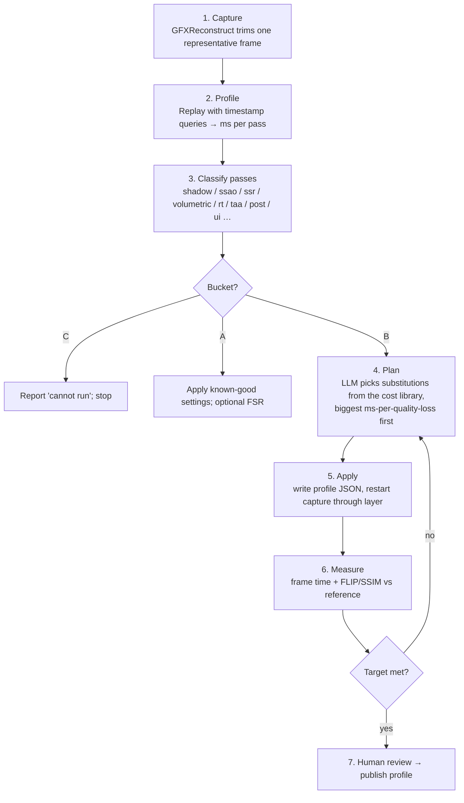

# 06 — The AI agent: how "an agent does all the work"

The agent never writes per-game code. It **profiles, classifies, chooses substitutions from a fixed
library, measures, and iterates** — producing the profile JSON that the layer (doc 05) consumes.
Humans review profiles; they do not author them.

## 1. The loop



Each iteration is seconds to minutes (replaying a trimmed capture, not playing the game), so the
agent can afford dozens of iterations per game.

## 2. Step detail

### 2.1 Capture
Run the game once through GFXReconstruct with `GFXRECON_CAPTURE_FRAMES=<n>` at a representative
moment (the user or a scripted camera path picks it). Output: `.gfxr` with setup + one frame.

### 2.2 Profile
Replay the capture through the Downshift layer in **profiling mode**: the layer inserts
`vkCmdWriteTimestamp` around every render pass / dispatch and emits `passes.json`:

```jsonc
[{ "idx": 17, "kind": "graphics", "shaders": ["ab12…"], "targets": [{"fmt":"D32","w":4096,"h":4096,"layers":4}], "ms": 2.9 }, …]
```

GFXReconstruct does not record timestamps itself; the layer adds them on replay.

### 2.3 Classify
A classifier maps each pass to a class using cheap structural signals, with an LLM only for the
ambiguous tail:

| Signal | Class |
|---|---|
| Depth-only target, square, array layers 2–4, drawn before main pass | `shadow-cascade` |
| Compute, reads depth + normals, writes R8 at ≤ full res | `ssao` |
| Compute/pixel, reads depth + colour, writes RGBA16F, loop over depth | `ssr` |
| Compute, writes 3D texture (froxel grid) | `volumetric` |
| Pipeline uses `OpRayQuery*` or RT pipeline | `rt-*` |
| Reads previous-frame colour + motion vectors | `taa` |
| Draws after TAA, full-screen triangle | `post` |
| Last passes, alpha-blended, no depth | `ui` (never touched) |

Signals come from spirv-reflect on the shader and the image metadata the layer already recorded.

### 2.4 Plan
Input: `passes.json` + the **cost library** (doc 02 table, encoded as data) + the target (1080p60) +
a quality floor. The planner (Claude via the API by default; any model that follows a schema) outputs
a ranked list of substitutions, each with expected ms saved and expected perceptual cost, and writes
the profile JSON. Deterministic rules handle the easy cases (always try FSR Balanced first; always
clamp 4K shadow maps to 2K); the model handles trade-offs and unfamiliar pass structures.

### 2.5 Apply + Measure
Replay with the new profile. Measure:
- **Frame time** — sum of pass timestamps, plus wall-clock replay time as a sanity check.
- **Perceptual quality** — NVIDIA FLIP and SSIM between the substituted frame and the *reference*
  frame (the same capture replayed with no substitutions, at the game's RTX-3050-Medium settings).
  FLIP is designed exactly for "would a human notice this difference in a rendered image".
- **Correctness** — `spirv-val` on every rewritten shader; any validation failure reverts that shader.

### 2.6 Iterate
Greedy with backtracking: apply substitutions in order of ms-saved / quality-lost; if a step pushes
FLIP over the floor, revert it and try the next. Stop when the target is met or the library is
exhausted (then report the best achieved and label the game "partially downshifted").

## 3. What the agent is *not* allowed to do

- Touch `ui` passes, or any pass that writes to a buffer later read by the CPU (gameplay logic).
- Emit a profile without `measured` numbers.
- Mark a Bucket C game as B. The extension check is deterministic and precedes the model.
- Modify game files on disk.

## 4. Model-agnostic interface

```
plan(passes.json, cost_library.json, target.json, previous_attempts[]) -> profile.json
```

Prompted with the schema from doc 05 §6 and a system prompt that encodes the rules in §3. The
default planner is Claude via the Claude API; the interface is a plain JSON contract so any model, or
a hand-written rule engine, can be swapped in.

## 5. Community loop

Profiles are data, so they are shareable: a `profiles/` directory keyed by executable hash, with the
measured numbers, lets one person's agent run benefit every 1060 owner. Human review before merge is
the quality gate.

## Sources

- [LunarG — GFXReconstruct: an engine for graphics API debugging and profiling v2 (PDF, capture/replay, frame trimming, CI focus)](https://www.lunarg.com/wp-content/uploads/2026/07/GFXReconstruct-an-Engine-for-Graphics-API-Debugging-and-Profiling-v2.pdf)
- [LunarG — Mastering GFXReconstruct Part 1 (GFXRECON_CAPTURE_FRAMES, gfxrecon.py optimize)](https://www.lunarg.com/mastering-gfxreconstuct-part-1/)
- [LunarG — GFXReconstruct VULFEB2023 (timestamps not captured)](https://www.lunarg.com/wp-content/uploads/2023/02/GFXReconstruct-VULFEB2023.pdf)
- [Vulkan Guide — Ways to provide SPIR-V](https://docs.vulkan.org/guide/latest/ways_to_provide_spirv.html)
- [Real-Time Rendering blog — measure techniques in ms, sub-ms precision with PIX](https://www.realtimerendering.com/blog/?p=125)
- NVIDIA FLIP metric — *(not retrieved during this research; see the "FLIP: A Difference Evaluator for Alternating Images" paper, HPG 2020, and the `NVlabs/flip` repository — confirm)*
